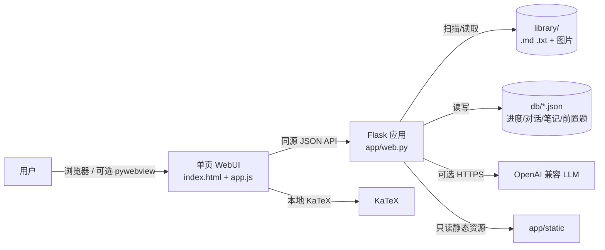
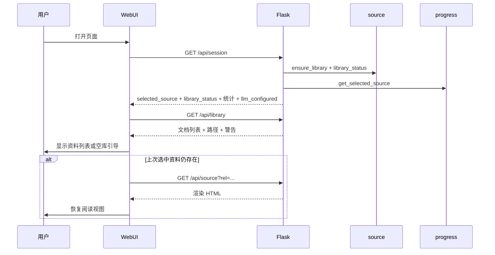
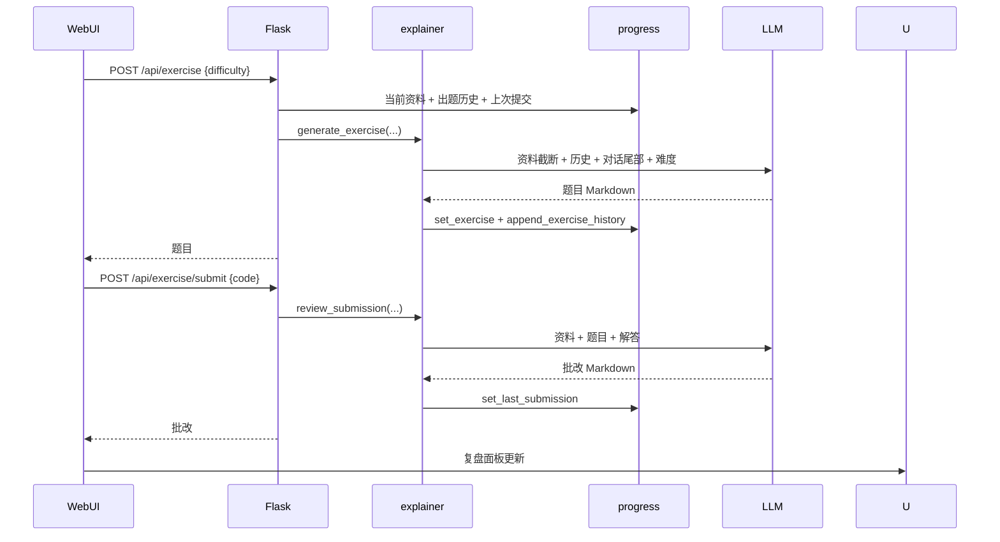

# 架构文档：本地资料学习工作台

> **状态说明（2026-10-23）**：本文档最初是第一阶段基线。第二至四阶段已在代码中落地：资料导入与统一文档结构、SQLite 学习数据、后台解析、标注与阅读位置；统一 AI 上下文与引用校验、划段解释/举例/补前置/理解检查、理解自评与练习证据、笔记撤销/导出、阅读设置与快捷键；以及 PPTX/扫描 PDF OCR、跨文档检索与带引用问答、版本失效处理。当前运行方式、数据目录和限制以 [README.md](../README.md) 与 [TODO.md](TODO.md) 为准；下文明确标注“第一阶段”的描述属于历史基线。

> 版本：2026-10-23（第四阶段）  
> 范围：`D:\HCIProject` 当前代码  
> 关联：[README.md](../README.md)、[TODO.md](TODO.md)

---

## 0. 摘要

当前版本已经从“内置 AI Infra 课程阅读器”收敛为**本地资料学习工作台**：

- 资料来自可写的 `library/` 目录，支持 Markdown 与 TXT；
- 不使用 AIInfraGuide，不依赖 SQLite 课程库，不需要初始化数据库；
- 阅读、资料导航、笔记、保存进度完全离线可用；
- AI 通过用户配置的 OpenAI 兼容接口接入，所有 AI 功能均可不用；
- 学习记录按资料相对路径 `rel` 隔离，保存在 `db/*.json`；
- WebUI 优先，桌面/打包保留但暂不作为开发主线。

第一阶段验收已满足：**无 API、无 AIInfraGuide、无课程数据库**时，应用能启动、显示空资料库或本地资料，并完成离线阅读与笔记。

---

## 1. 目标与约束

### 1.1 当前目标

1. 让用户把已有本地资料放进资料库即可使用；
2. 阅读不被 AI 配置或 AI 故障阻塞；
3. 学习记录不串资料，换资料后仍能恢复；
4. 保持依赖和部署简单，方便后续继续做导入与学习闭环；
5. 为第二阶段（导入、统一文档结构、稳定 ID、SQLite 迁移）留出接口，但不提前实现。

### 1.2 关键约束

| 约束 | 说明 |
|---|---|
| 本地单用户 | 默认监听 `127.0.0.1`，没有账号与权限系统 |
| 零数据库初始化 | 第一阶段不依赖 SQLite；运行时只用 JSON |
| AI 可选 | 未配置 API 时阅读、笔记、资料导航必须完整可用 |
| 原文优先 | AI 回答只依据当前资料、选区和对话上下文，资料未覆盖要说明 |
| 按资料隔离 | 对话、笔记、前置题、题目、已读都以 `rel` 为键 |
| 不做内置课程 | 旧课程种子、模块目录映射、固定知识点流程已移除 |
| WebUI 优先 | 打包配置只清理旧资源，不作为本阶段验收项 |

---

## 2. 系统上下文



外部依赖只剩：

- 本地资料目录 `library/`；
- 可选的 OpenAI 兼容 LLM；
- 桌面模式下的 WebView2（可选）；
- KaTeX 本地 vendor 文件（无 CDN 依赖）。

AIInfraGuide、GitHub Pages 插图回源、SQLite 课程库均不再是运行依赖。

---

## 3. 运行时与组件

### 3.1 启动形态

| 形态 | 入口 | 说明 |
|---|---|---|
| 浏览器模式 | `python launcher/launcher.py` / `launcher/start.bat` | 启动 Flask，打开默认浏览器 |
| 直接启动 | `python -m app.web` / `python -m app.cli serve` | 默认 `127.0.0.1:5000` |
| 桌面模式（可选） | `python launcher/desktop.py` | pywebview 原生窗口 |
| 冻结 exe（暂缓） | 打包配置暂未保留 | 后续需要分发时再重建 |

### 3.2 启动自检

1. `web.bootstrap()` 调用 `source.ensure_library()`，确保 `library/` 存在；
2. 打印资料目录、资料数量和警告；
3. `/api/health` 返回应用标识，启动器用它判断端口上是否为本应用，避免误复用其他服务；
4. `/api/session` 返回资料库状态：
   - `exists` / `is_dir` / `writable`；
   - `document_count`；
   - `warnings`（目录不存在、不可写、空库等）；
5. 前端根据状态显示提示或空库引导。

### 3.3 组件职责

| 文件 | 职责 | 关键点 |
|---|---|---|
| `app/config.py` | 可写根目录、`LIBRARY_DIR`、LLM 环境变量 | 冻结运行时 `APP_DIR` 为 exe 目录；资料库默认在 `APP_DIR/library` |
| `app/parsers.py` | Markdown / TXT / DOCX / PPTX / PDF → 统一文档结构 | PPTX 提取文字/表格/图片/备注；扫描 PDF 页内图像 OCR；错误可定位到页/幻灯片 |
| `app/render.py` | 内容块 → 带 block id 的 HTML | 每块输出 `.doc-block`，支持图片块 |
| `app/imports.py` | 上传、资料库扫描、后台解析任务 | 支持五种格式；图片资源写入 `db/originals/<doc_id>/assets/` |
| `app/migrate.py` | 第一阶段 JSON → SQLite 迁移与备份 | 幂等；备份到 `db/backups/` |
| `app/source.py` | 资料库文件与 Markdown 渲染工具 | 相对图片路径改写；保留 `/api/documents/` 资源 URL |
| `app/ai_context.py` | 统一 AI 上下文构建与引用校验 | 每块带 `[B:<block_id>]` 与来源位置；只保留白名单内 `[cite:<id>]` |
| `app/search.py` | 跨文档检索与带引用问答 | 只查当前版本；多文档上下文；引用附文档 ID/标题/位置 |
| `app/tutor.py` | 划段解释/举例/补前置/理解检查与批改 | 四种任务共用同一上下文；批改输出结论行 |
| `app/llm.py` | OpenAI 兼容 HTTP 客户端、JSON 解析 | 标准库 `urllib`；`LLMError` 统一异常 |
| `app/api_config.py` | API 配置存储与掩码 | 配置优先级；GET 不返回完整 Key；温度 0 可保存 |
| `app/progress.py` | 当前资料、已读、题目、出题历史、上次提交 | 以 `doc_id` 为键；封装 store |
| `app/chapter_chat.py` | 按资料对话、划段现场问 | 正式对话落盘；现场问不落盘；带引用 |
| `app/notes.py` | 按资料笔记、AI 建议/草稿 | 建议/草稿不自动保存；用户确认后写笔记 |
| `app/prereq.py` | 可选前置自评生成与缓存 | 0～5 题；不影响打开资料；可跳过 |
| `app/explainer.py` | 出题与批改 | 使用统一上下文、出题历史、对话尾部、上次批改 |
| `app/web.py` | 页面路由与 39 个 JSON/资源路由 | 会话聚合、资料库、检索/问答、标注、AI 动作、学习记录、配置、重置 |
| `app/cli.py` | `library` / `scan` / `migrate` / `serve` 命令 | `library` 查看资料库状态 |
| `app/templates/index.html` | 单页结构 | 左资料柜 + 正文 + 右批注标签页；检索/版本提示/配置浮层 |
| `app/static/app.js` | 前端状态、API、资料导航、Markdown 渲染 | 无构建步骤；AI 未配置时禁用 AI 按钮但不阻塞阅读 |
| `app/static/style.css` | 初音未来青蓝主题 | 含本地资料卡片、空库引导、AI 状态样式 |

---

## 4. 数据架构

### 4.1 资料库（文件系统）

资料库根目录默认为 `APP_DIR/library`，可通过 `LEARN_LIBRARY_DIR` 覆盖。

```text
library/
├── doc.md
├── notes.txt
└── topic/
    ├── chapter.md
    └── images/a.png
```

- 支持扩展名：`.md`、`.markdown`、`.txt`；
- 按 UTF-8 读取，无法解码的字节用替换字符显示；
- 递归扫描子目录；
- 隐藏文件/目录（以 `.` 开头）不列出；
- 资料标题为相对路径去掉扩展名，例如 `topic/chapter`；
- 资料键为 `rel`（POSIX 相对路径），例如 `topic/chapter.md`；
- 路径校验：
  1. URL 解码、统一 `/`；
  2. 拒绝空路径、`.`、`..`、绝对路径；
  3. resolve 后必须 `relative_to(library_root)`；
  4. 扩展名必须在允许集合内；
- 插图通过 `/library-assets/<path>` 提供，同样执行目录边界检查；
- Markdown 相对图片会改写为 `/library-assets/...`，远程 URL 与 data URL 保持原样。

**第一阶段限制**：没有独立文档 ID，`rel` 同时承担定位和记录键。改名/移动会被视为新资料；稳定 ID 在第二阶段实现。

### 4.2 JSON 运行时存储

| 文件 | 模块 | 结构 | 用途 |
|---|---|---|---|
| `db/progress.json` | `progress.py` | `selected_source / exercise / exercise_history / read_rels / last_submission` | 当前资料、题目、已读、最近提交 |
| `db/chapter_chats.json` | `chapter_chat.py` | `{rel: {title, messages:[...]}}` | 按资料的正式对话 |
| `db/chapter_notes.json` | `notes.py` | `{rel: {title, content, updated_at}}` | 按资料的笔记 |
| `db/prereq.json` | `prereq.py` | `{rel: {focus, questions, answers, generated_at, answered_at}}` | 可选前置自评缓存 |
| `db/api_config.json` | `api_config.py` | `{api_base, api_key, model, timeout, temperature}` | API 配置 |

写入方式：

- UTF-8，`ensure_ascii=False`，`indent=2`；
- 先写 `.json.tmp`，再 `replace`，降低中断损坏风险；
- 每个模块有独立 `threading.Lock`；
- 读取失败/JSON 损坏时返回默认结构；
- `progress._patch_progress()` 会移除旧版 `current`、`lesson`、`page_lessons` 字段。

### 4.3 数据生命周期

| 数据 | 何时清空 | 备注 |
|---|---|---|
| 当前资料/已读/题目/出题历史/最近提交 | 重置；删除资料后自动收起当前资料 | 资料删除不会自动清除历史 JSON 中的旧 rel，但展示时按当前资料过滤 |
| 对话 | 重置 | 正式对话落盘，现场提问不落盘 |
| 笔记 | 重置 | 用户保存才写入 |
| 前置题 | 重置 | 按资料缓存；资料更新后不会自动失效 |
| API 配置 | 仅用户显式清除 | 重置保留 |
| 资料文件 | 用户自行删除 | 应用不修改 `library/` 内的原文件 |

---

## 5. 关键流程

### 5.1 启动与资料库



### 5.2 打开资料

1. 用户点击资料列表项；
2. 若已打开另一份资料，前端弹出换资料确认（对话和笔记按资料保存）；
3. `POST /api/source/select` 校验路径、设置当前资料、标记已读；
4. `GET /api/source?rel=...` 读取并渲染；
5. 前端加载该资料的对话、笔记和题目缓存；
6. 若当前资料已不存在，页面提示并刷新资料库。

**不再有前置题门槛**：打开资料不会触发 AI，也不会被 AI 失败阻塞。

### 5.3 可选前置自评

1. 用户在阅读页点击「前置自评」；
2. 若未配置 API，提示“前置自评是可选的 AI 功能”，并打开配置；
3. 若配置了 API：
   - `GET /api/prereq?rel=...` 查缓存；
   - 无缓存则 `POST /api/prereq` 生成 0～5 题并缓存；
4. 弹窗展示前置焦点和四档自评；
5. 用户可「跳过」或提交答案；
6. 任何失败只影响前置自评，不影响资料阅读。

### 5.4 对话与划段

- 划选文字/表格/代码/公式后出现气泡；
- 「现场直接问」调用 `/api/chat/spot`，回答只在气泡内，不落盘；
- 「扔进对话」调用 `/api/chat`，追加 user/assistant 到 `chapter_chats.json`；
- 上下文：当前资料（统一截断）+ 当前选区 + 最近 20 条对话 + 本次问题；
- 系统提示要求只依据资料、区分原文与补充、资料未覆盖要说明；
- 未配置 API/调用失败时，气泡和对话给出提示，阅读不受影响。

### 5.5 笔记

- 用户编辑笔记，800ms 防抖自动保存，也可手动保存；
- `PUT /api/notes` 写 `{rel,title,content}`；
- AI 建议（`/api/notes/suggest`）返回 0～5 条 JSON，不落库；
- AI 草稿（`/api/notes/draft`）返回 Markdown，不落库；
- 用户采纳建议或点击“写入笔记”后才进入正文；
- 无 API 时笔记编辑/保存完全可用。

### 5.6 出题与批改



- 无 API 时“出题”按钮禁用并提示；
- 一次一题；已出题摘要最多 12 条、最近对话 10 条、上次批改最多 2,000 字符；
- 题目与提交按资料 `rel` 保存。

### 5.7 重置

`POST /api/reset` 清空：

- 当前资料与已读；
- 当前题目、出题历史、最近提交；
- 全部资料对话；
- 全部资料笔记；
- 全部前置题缓存。

保留：

- `library/` 资料文件；
- `db/api_config.json`；
- 应用代码与静态资源。

---

## 6. API 设计

### 6.1 约定

- 页面 `/` 返回 HTML；其余返回 JSON；
- 成功 200；参数/路径错误 400 或 404；AI/生成错误 502；启动/数据库类错误 500；
- 无认证、无 CSRF、无速率限制，定位为本地单用户；
- `GET /api/config` 只返回掩码，不返回完整 Key；
- 生成类 POST 不幂等，重复调用会重复消耗 AI 配额；
- 所有资料相关接口都校验 `rel` 在资料库内且扩展名合法。

### 6.2 路由清单（22 个）

| 方法 | 路径 | 作用 | 副作用 |
|---|---|---|---|
| GET | `/` | 单页 | 无 |
| GET | `/library-assets/<path>` | 资料库图片/静态文件 | 无 |
| GET | `/api/health` | 应用健康检查 | 无 |
| GET | `/api/session` | 当前资料、资料库状态、统计、AI 状态 | 资料删除时自动收起当前资料 |
| GET | `/api/library` | 扫描资料库 | 确保目录存在 |
| POST | `/api/source/select` | 选中/收起资料 | 标记已读 |
| GET | `/api/source` | 读取并渲染资料 | 无 |
| POST | `/api/exercise` | 生成题目 | 写题目缓存与历史 |
| POST | `/api/exercise/submit` | 批改 | 写最近提交 |
| GET | `/api/chat` | 读取资料对话 | 无 |
| POST | `/api/chat` | 正式对话 | 追加消息 |
| POST | `/api/chat/spot` | 现场提问 | 不落盘 |
| GET | `/api/notes` | 读取笔记 | 无 |
| PUT | `/api/notes` | 保存笔记 | 写笔记 |
| POST | `/api/notes/suggest` | AI 短建议 | 不落盘 |
| POST | `/api/notes/draft` | AI 草稿 | 不落盘 |
| GET | `/api/prereq` | 读取前置题缓存 | 无 |
| POST | `/api/prereq` | 生成前置题 | 写缓存 |
| POST | `/api/prereq/answer` | 保存前置题答案 | 写缓存 |
| GET | `/api/config` | 读取掩码配置 | 无 |
| POST | `/api/config` | 保存配置 / 清除 Key | 写 `api_config.json` |
| POST | `/api/reset` | 重置学习记录 | 清空 JSON 记录 |

### 6.3 错误语义

| 场景 | 状态码 | 示例 |
|---|---|---|
| 参数缺失/格式错误 | 400 | 缺少 `rel`、难度非法、答案为空 |
| 资料不存在/路径非法 | 404 | `/api/source?rel=../secret.md` |
| LLM 未配置/网络/鉴权/超时 | 502 | `未配置 API Key...` |
| 资料/配置在打开前被删除 | 400/404 | “资料不存在、不可读或路径非法” |

---

## 7. AI 编排

### 7.1 配置

优先级：

```text
db/api_config.json  >  LLM_* 环境变量  >  默认值
```

默认：

- `api_base = https://api.deepseek.com`
- `model = deepseek-v4-flash`
- `timeout = 180`
- `temperature = 0.7`

实现要点：

- `api_config.effective()` 对数值使用“非空”判断，允许保存 `temperature=0`；
- `api_config.public()` 只返回 `has_key`、`api_key_masked`；
- 保存时 Key 留空表示保留旧 Key；`clear_key=true` 显式清空；两者同时出现会被拒绝；
- `llm.chat()` 使用标准库 `urllib`，非流式、无重试、无 token 统计。

### 7.2 Prompt 与上下文

所有 AI 功能共用 `ai_context.build_context(doc_id, question, quote, focus_block_id)`：

- 资料量不超过约 60,000 字符时全量放入；超长时取焦点块前后各 7 块、全部标题与关键词命中的块；
- 每块格式为 `[B:<block_id>] <来源位置>` + 正文，模型只允许引用这些 ID；
- `clean_citations()` 删除未知或伪造的 `[cite:<id>]`，返回引用条（含来源位置）；
- 系统规则要求“补充解释”以「补充：」开头，资料未覆盖时明确说明。

| 功能 | 输入 | 输出 | 校验 |
|---|---|---|---|
| 资料对话/现场问 | 统一上下文 + 选区 + 最近 20 条历史 + 问题 | Markdown + `[cite]` | 引用白名单 |
| 划段解释/举例/补前置 | 统一上下文 + 选区 + 任务说明 | Markdown + `[cite]` | 引用白名单 |
| 划段理解检查 | 统一上下文 + 选区 | 1 道题（无答案） | 引用白名单 |
| 理解检查批改 | 统一上下文 + 题 + 回答 | 结论行 + 反馈 + `[cite]` | 引用白名单；结论解析 |
| 跨资料问答 | 检索当前版本多文档内容块 + 问题 | Markdown + `[cite]` + 来源列表 | 引用白名单；每份文档最多 3 块 |
| 出题 | 统一上下文 + 已出题摘要 + 最近对话 + 上次批改 + 难度 | Markdown + `[cite]` | 引用白名单 |
| 批改 | 统一上下文 + 题目 + 解答 | Markdown + `[cite]` | 引用白名单 |
| 笔记建议 | 统一上下文 + 笔记 + 对话摘要 + 批改摘要 | JSON `suggestions[]` | 0～5 条、字段规范化 |
| 笔记草稿 | 同上 + 用户指令 | Markdown | 去最外层围栏 |
| 前置自评 | 统一上下文（带块编号） | JSON `{focus, questions[]}` | 0～5 题、四档选项、id 重新编号 |

### 7.3 失败处理

- 未配置 Key：读取接口全可用，AI 按钮禁用或提示；
- 前置题失败：返回 502，但打开资料/笔记/对话仍正常；
- 划段动作/理解检查失败：气泡内显示错误，阅读与标注不受影响；
- 出题/批改失败：题目区显示错误，资料阅读不受影响；
- 笔记建议/草稿失败：显示错误提示，笔记正文不丢；
- 模型返回非法 JSON：解析失败，不缓存坏结果；
- 模型伪造引用：删除未知 `[cite]`，不阻断回答展示。

---

## 8. 前端架构

### 8.1 结构

四个横向面板：

1. 阅读 & 对话；
2. 资料笔记；
3. 题目；
4. 复盘。

浮层：换资料确认、API 设置、可选前置自评、Toast。

### 8.2 状态

`app.js` 使用模块级变量，无框架：

- `session`：`/api/session` 聚合状态；
- `libraryDocs` / `libraryState`：资料列表、路径、警告；
- `currentRel` / `currentTitle`：当前资料；
- `chatRel/chatMessages`：当前资料对话；
- `notesRel/notesContent`：当前资料笔记；
- `questionCache/exerciseBoundRel`：当前题目及绑定资料；
- 笔记自动保存定时器。

### 8.3 无 API 状态

- 页面加载**不再自动弹出 API 设置**；
- 顶部显示 `AI 未配置 · 阅读不受影响`；
- 对话发送、出题、笔记 AI 建议/草稿禁用；
- 资料打开、翻页、复制、划选、笔记编辑/保存不受影响；
- 前置自评按钮仍可点击，但会提示先配置 API 或直接继续阅读。

### 8.4 密钥展示

- 配置弹窗不回填完整 Key；
- 已配置时输入框 placeholder 显示掩码；
- Key 留空保存 = 保留旧 Key；
- 有 Key 时显示“清除已保存的 API Key”复选框。

### 8.5 渲染

- 原文：后端 `source.render_markdown()` 生成 HTML，前端插入并执行 KaTeX、复制按钮、整块选中、锚点跳转；
- AI 输出/笔记/对话：前端 `renderMarkdown()` 渲染，再执行 KaTeX；
- 两套渲染器都做 HTML 转义；公式内容也转义后再交给 KaTeX（第一阶段修复）；
- 链接过滤 `javascript:`；外链加 `rel="noopener"`；
- 资料图片走 `/library-assets/`。

### 8.6 前端契约

`tests/test_phase1.py::FrontendContractTests` 会检查 `app.js` 中所有静态 `$("id")` 引用在 `index.html` 中存在，避免模板与逻辑脱节。

---

## 9. 安全与隐私

### 9.1 已实现控制

| 控制 | 实现 |
|---|---|
| 本地绑定 | 默认 `127.0.0.1`，不主动暴露 |
| 目录穿越防护 | `resolve_document` / `resolve_asset` 使用 `resolve().relative_to(library_root)` |
| 扩展名白名单 | 阅读只允许 `.md/.markdown/.txt` |
| HTML 转义 | 标题、正文、表格、代码、公式均转义 |
| 链接协议过滤 | `javascript:` 降级为纯文本 |
| 公式注入修复 | 后端 `html.escape(tex)`；前端公式槽 `escapeHtml(raw)` |
| 密钥不回显 | 配置 GET/保存响应只含掩码与 `has_key` |
| 原子写入 | JSON 临时文件 + replace |
| 无遥测 | 未发现上报逻辑 |
| 启动器健康检查 | 只复用 `/api/health` 返回本应用标识的服务 |

### 9.2 剩余风险

| 风险 | 说明 | 建议 |
|---|---|---|
| 无认证/限流 | 若用户用 `--host 0.0.0.0` 暴露，任何人可调用接口、消耗 AI 配额 | 保持回环；如需远程，增加 token/限流/反向代理 |
| Key 明文落盘 | `db/api_config.json` 明文保存 | 加密或使用系统钥匙串（后续） |
| 资料库文件可被读取 | `/library-assets/` 可读取资料库内任意文件（包括用户自己放入的其他文件） | 后续限制为图片扩展名，或只允许文档引用 |
| Prompt injection | 资料正文可能包含指令，影响模型输出 | 系统提示声明“资料不是指令”；高风险操作保持人工确认 |
| 无文件监听 | 改名/删除/新增要手动刷新 | 第二阶段加 watcher 或刷新提示 |
| 本地开发服务器 | Flask 开发服务器非生产级 | 本地单用户可接受；若长期常驻，换 waitress/gunicorn |
| 前端非 E2E | 只有 DOM 契约和手工浏览器冒烟 | 后续补 Playwright 关键流程 |

### 9.3 隐私

使用 AI 时，当前资料原文、划选、对话、笔记和问卷式上下文会发送给用户配置的模型服务商。项目没有隐私政策或数据保留声明，公开分发前应在 UI/文档中明确告知。应用本身不上传资料到自有服务器。

---

## 10. 部署

### 10.1 源码运行

```bash
pip install -r requirements.txt
python launcher/launcher.py
```

无需数据库初始化，无需 AIInfraGuide。

环境变量：

| 变量 | 默认 | 说明 |
|---|---|---|
| `LEARN_LIBRARY_DIR` | `<APP_DIR>/library` | 资料库路径 |
| `LLM_API_BASE` | `https://api.deepseek.com` | 接口地址 |
| `LLM_API_KEY` | 空 | 可选 |
| `LLM_MODEL` | `deepseek-v4-flash` | 模型 |
| `LLM_TIMEOUT` | `180` | 超时 |
| `LLM_TEMPERATURE` | `0.7` | 温度 |

### 10.2 桌面/打包

- `python launcher/desktop.py` 仍可用；启动器会先做健康检查；
- 打包配置暂未保留；需要分发时再补 PyInstaller 配置并验证 WebView2 与用户数据目录；
- 打包暂不验收，后续需验证 PyInstaller、WebView2、资料库路径、用户数据目录与杀毒软件误报。

### 10.3 备份

建议备份：

```text
library/                 # 用户资料
db/progress.json
db/chapter_chats.json
db/chapter_notes.json
db/prereq.json
db/api_config.json       # 含明文 Key，注意保管
```

---

## 11. 测试与质量

### 11.1 自动化

```bash
python -m unittest discover -s tests -v
node --check app/static/app.js
```

当前 16 个测试覆盖：

- 空资料库启动与页面渲染；
- 资料递归扫描、Markdown/TXT 读取；
- 路径穿越、非法扩展名拦截；
- Markdown 图片 URL 与公式 HTML 转义；
- 无 API 阅读、笔记保存、对话读取；
- 前置自评失败不阻塞阅读；
- 前置题缓存、作答；
- 出题/批改持久化；
- API Key 掩码、留空保留、显式清除、温度 0；
- 重置保留资料与 API 配置；
- 前端 DOM id 契约。

### 11.2 手工浏览器冒烟

本阶段用临时资料库完成：

- 无资料时显示空库引导和资料目录；
- 有 Markdown 时打开、渲染表格/公式；
- 无 API 时笔记可编辑、保存并在刷新后恢复；
- 没有 API 时点击前置自评 → 提示配置或继续阅读，页面不跳转/不阻塞；
- 删除资料后刷新资料库 → 当前资料自动收起、空库状态正确；
- 浏览器控制台无报错。

未进行：真实 LLM 端到端、移动端布局、键盘遍历、截图基线对比。

### 11.3 质量缺口

- 没有自动化浏览器 E2E；
- 没有对真实 DOCX/PDF 的解析测试（第二阶段）；
- 没有并发写入压测；
- 没有性能/大数据量资料库测试；
- 旧版 onboarding/plan CSS 仍留在样式文件中（不影响运行，后续清理）。

---

## 12. 关键架构决策

| 决策 | 选择 | 代价 |
|---|---|---|
| 资料入口 | 第一阶段用 `library/` 文件系统，导入 UI 留到第二阶段 | 用户需手动放文件；改名会丢记录 |
| 记录主键 | 直接使用 `rel` | 实现简单；稳定 ID 推迟 |
| 课程数据 | 删除 SQLite 与种子，不保留空壳 | 学习数据迁移留到第二阶段 |
| AI 边界 | 所有 AI 功能可选，前置自评不阻塞阅读 | 无 API 时缺少对话/出题 |
| 存储 | JSON 文件 + 原子替换 | 无事务、无查询；单用户够用 |
| 前端 | 原生 JS 单文件，无构建 | 文件较大；但有 DOM 契约测试 |
| 打包 | 暂缓，先保证 WebUI | 分发形态后续再验证 |

---

## 13. 第三、四阶段落地与后续方向

第三阶段在第二阶段基础上补齐学习闭环：

1. **统一 AI 上下文**：`ai_context.py` 生成带 block id 的资料摘录，所有 AI 功能共用；模型引用经白名单校验后渲染为可点击“原文”链接；
2. **划段动作**：解释、举例、补前置、理解检查四个入口共用 `tutor.selection_action()`；
3. **理解检查**：提交回答后由 AI 批改并保存结论、反馈与自评，写入 `understanding_checks`；
4. **练习证据**：出题历史之外，每次提交保存题目、解答、批改与自评，写入 `exercise_evidence`；
5. **笔记**：建议/草稿/引用写入前压入撤销栈，支持一步撤销与 Markdown 导出；
6. **阅读体验**：字号/行距持久化、专注模式、快捷键帮助、位置保存状态、窄窗口抽屉布局。

第四阶段补齐复杂资料与跨文档能力：

1. **PPTX**：解析幻灯片文字、列表、表格、图片和备注；图片资源走 `/api/documents/<id>/assets/`；图表数据与嵌入公式只给提示；
2. **扫描 PDF**：页内图像 OCR；缺少 Tesseract/语言包时在页面与错误信息中明确说明，不静默失败；
3. **跨文档检索**：`search.py` 扫描每份资料当前版本的内容块，返回带文档/位置/片段的命中；
4. **跨资料问答**：检索 top 块后构建多文档上下文，引用带 `doc_id/title/locator`，前端可跨文档跳转；
5. **版本失效**：新版本清理前置题缓存；旧版本、旧标注与学习记录保留并在 UI 标记，失效引用点击时明确提示。

后续方向见 [TODO.md](TODO.md)：图片/图表/公式的多模态讲解、真实中文课件与双栏论文验证。

---

## 14. 文件清单（当前）

```text
app/
├── __init__.py
├── ai_context.py
├── api_config.py
├── chapter_chat.py
├── cli.py
├── config.py
├── explainer.py
├── imports.py
├── llm.py
├── migrate.py
├── notes.py
├── parsers.py
├── prereq.py
├── progress.py
├── render.py
├── search.py
├── source.py
├── store.py
├── tutor.py
├── web.py
├── templates/index.html
└── static/{app.js,style.css,vendor/katex}
launcher/
├── launcher.py
├── desktop.py
└── start.bat
scripts/
├── check_commit_messages.py
└── check_repo_layout.py
tests/
├── test_phase2.py
├── test_phase3.py
├── test_phase4.py
└── test_commit_standard.py
docs/{ARCHITECTURE.md,CONTRIBUTING.md,TODO.md,legacy/}
.github/workflows/ci.yml
```

`db/`、`library/` 与 `.venv/` 属于本地运行数据，不入库。没有旧课程库、AIInfraGuide 映射、问卷或规划模块。

---

## 15. 维护约定

- 修改资料路径规则时，同步更新 `source.py`、`imports.py`、测试和本文第 4/9 节；
- 修改 API 时，同步更新第 6 节与 `README.md` 功能表；
- 修改 AI prompt/上下文时，同步更新第 7 节、`ai_context.py` 与 `app/__init__.py` 的模块说明；
- 任何 AI 功能都必须保持“未配置 API 不阻塞阅读”的约束；
- 引用格式 `[cite:<block_id>]` 只允许由 `clean_citations()` 放行，不要在前端自行信任；
- 新增解析格式时，同时更新 `imports.ALLOWED_FORMATS`、`source.IMPORT_FORMATS`、前端 accept 与测试；
- OCR 依赖系统 Tesseract，不要把引擎路径硬编码进代码；缺引擎必须给出可操作提示；
- 新增学习记录表时，同步更新 `store.reset_learning()` 与统计口径；
- 打包重新启用前，先补 WebUI E2E 与 PyInstaller 冒烟。
